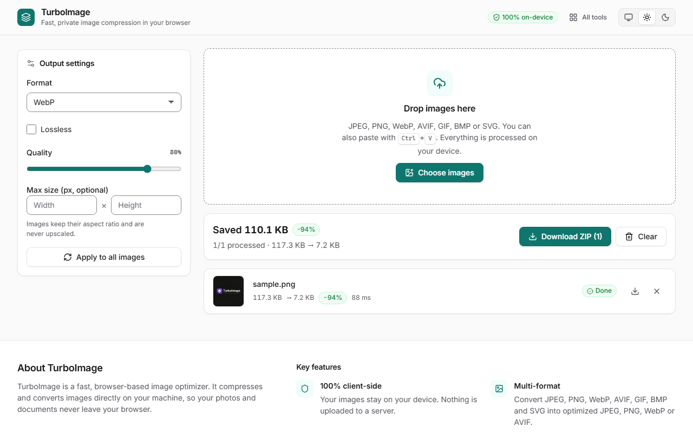
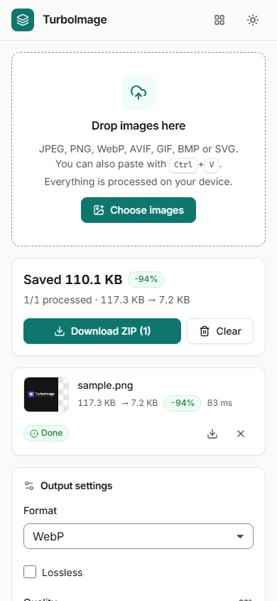
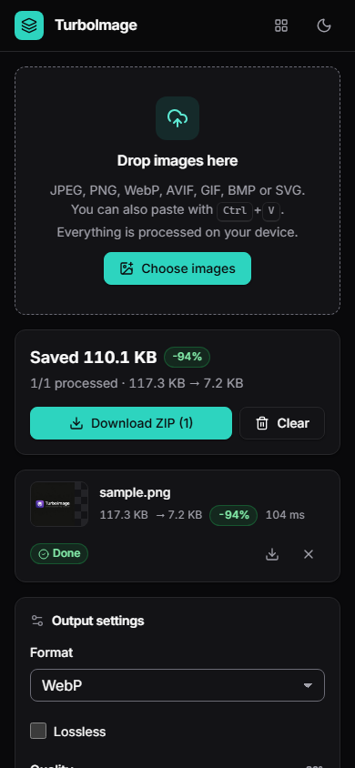

# TurboImage ⚡

[Live Demo](https://chrisjdj.github.io/Turbo-Image/)


TurboImage is a high-performance, browser-based image compression and conversion tool. It processes all images locally on your device, ensuring maximum privacy and speed without ever uploading your files to a server.

---
<picture>
  <source media="(prefers-color-scheme: dark)" srcset="docs/screenshots/dark-desktop.png" />
  
</picture>

| Light | Dark |
|---|---|
|  |  |

---

## ✨ Features

- **Extreme Privacy**: All processing happens locally in your browser. No server-side uploads.
- **Turbo Speed**: Utilizes a combination of Web Workers, WASM-powered codecs, and hardware-accelerated rasterization.
- **Robust SVG Support**: Custom handling for SVGs to bypass common browser decoding and transfer restrictions, including support for large files (tested up to 44MB+).
- **Format Support**: Convert and optimize JPEG, PNG, WebP, and AVIF.
- **Batch Processing**: Parallelized optimization using a dynamic worker thread pool.
- **Zero-Copy Memory**: Uses `ImageBitmap` transfers for minimal memory overhead.
- **Before/After Compare**: Slider comparison of the original and optimized image.
- **Modern UI**: Clean, mobile-first interface that works from 320px phones to wide desktops.
- **System / Light / Dark Theme**: Follows your OS setting by default (and updates live when it changes); a manual choice is remembered across all the tools in the suite.
- **Accessible**: WCAG 2.2 AA contrast in both themes, full keyboard support, skip link, native dialogs and reduced-motion support.

## 🛠️ Tech Stack

- **Core**: React 19 + TypeScript + Vite
- **Processing**: 
  - [jsquash](https://github.com/GoogleChromeLabs/jsquash) (WASM codecs for JPEG, PNG, WebP, and AVIF)
  - OffscreenCanvas for hardware-accelerated resizing
  - custom `WorkerPool` for parallel task scheduling
- **Icons**: Lucide React
- **Styling**: SCSS (Sass) with a shared token-based design system (see [DESIGN.md](./DESIGN.md))
- **Font**: Inter Variable (self-hosted via Fontsource)
- **Utilities**: Comlink, JSZip

## 📁 Project Structure

```text
/src
  /components      # AppHeader, ThemeSwitch, UploadZone, SettingsPanel, SummaryBar, QueueList, CompareModal, Footer
  /hooks           # useImageQueue, usePersistentState, useTheme
  /scheduler       # WorkerPool management and task scheduling
  /styles          # Design system: tokens, theme, base, components, shell (shared) + app styles
  /utils           # Shared logic (image processing, types)
  /workers         # Web Workers for off-main-thread processing
  App.tsx          # Page layout and app state
/docs/screenshots  # README screenshots
DESIGN.md          # Design system reference (tokens, theme, layout, components)
```

## 🚀 Getting Started

1. **Install Dependencies**:
   ```bash
   npm install
   ```

2. **Run Development Server**:
   ```bash
   npm run dev
   ```

3. **Build for Production**:
   ```bash
   npm run build
   ```

4. **Lint and Test**:
   ```bash
   npm run lint
   npm test
   ```

## 🎨 Design & Theming

The UI uses the design system shared by all the tools in the suite. Read [DESIGN.md](./DESIGN.md) before changing styles: components must use semantic tokens (no hard-coded colours) and work in both themes at every breakpoint. Release notes are in [CHANGELOG.md](./CHANGELOG.md).

## 📄 License

This project is licensed under the **Creative Commons Attribution-NonCommercial-ShareAlike 4.0 International License**.

You are free to use, modify, and share this project for **non-commercial purposes** with appropriate credit. Commercial use is not permitted. See the [LICENSE](./LICENSE) file for details.

